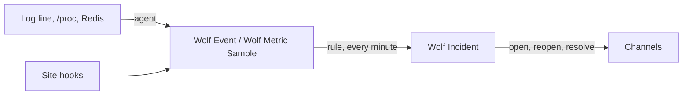

## Scope: site, bench, host

Every record carries up to three names. Wolf always reads them in this order:

| Scope | Is | Example |
|---|---|---|
| **site** | a Frappe site | `erp.client.com` |
| **bench** | the bench that serves it | `frappe-bench` |
| **host** | the Linux machine the agent runs on | `bench-01` |

Host-wide records (SSH logins, listening services) have no site. Rules group by one of these, and
[user scopes](/security/access) restrict who sees which.

## From a log line to an alert

1. The **agent** parses logs and reads system state. It sends events and metric samples every
   `push_interval` (30 s).
2. The **site** stores them. Events with the same fingerprint are counted on one row (**Count**,
   **Last Seen**) instead of piling up.
3. Every minute, each **alert rule** reads its window. When its condition holds, it opens an
   **incident** per group, or feeds the incident already open.
4. The incident notifies its **channels** when it opens, reopens, escalates and resolves, never
   on every event.

## The objects

| DocType | What it holds |
|---|---|
| **Wolf Event** | Something that happened: `error`, `cron_failure`, `worker_failure`, `security`, `host_metric_alert`, `deployment`. Has a category (for example `web_attack_probe`), a severity (`info`, `warning`, `critical`), a scope, a count and a JSON payload. |
| **Wolf Metric Sample** | One value of one metric (`queue_length`, `http_502`, `tls_days_left`…) for one scope at one time. Rolled up into **Wolf Metric Rollup** by minute and by hour. See [Metric storage](/reference/metric-storage). |
| **Wolf Alert Rule** | *When X > Y for Z minutes, send alert.* Signal, aggregation, window, group by, channels. See [Alert rules](/alerts/rules). |
| **Wolf Incident** | Events that share a cause, for one group of one rule. Status `Open`, `Acknowledged` or `Resolved`. Linked to the deployment that preceded it. See [Incidents](/alerts/incidents). |
| **Wolf Silence** | A maintenance window: incidents still open, notifications wait. |
| **Wolf Agent** | One registered host, satellite site or integration, with its last push and clock skew. |
| **Wolf Settings** | Retention, signals, agents, SIEM export, threat intelligence. |

## Severity

Each severity has a colour and a shape, so it never depends on colour alone:

| Severity | Glyph | Meaning |
|---|---|---|
| `info` | ○ | Worth knowing. |
| `warning` | ◐ | Look at it today. |
| `critical` | ● | Someone wakes up. |
| resolved | ✓ | Back to normal. |

## Deployments

A `deployment` event marks the moment code changed: a `bench migrate` on the Wolf site, a
Pilot task, or `wolf-agent mark-deployment`. Rules can require a recent deployment (the
*502 spike after deployment* preset), and incidents show the deployment that preceded them, so the
timeline reads "502s started 4 minutes after the 01:47 deploy".

## Where to look

- **Wolf UI** at `/wolf`: the security overview (its home page), incidents, explorers,
  security, operations, monitoring. For Wolf Users and Wolf Managers.
- **Desk**: every DocType, configuration, reports such as **Wolf Incident Metrics**.
