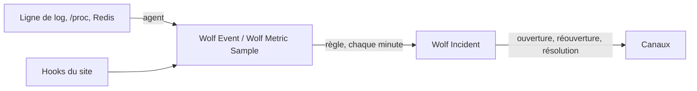

## Périmètre : site, bench, hôte

Chaque enregistrement porte jusqu'à trois noms. Wolf les lit toujours dans cet ordre :

| Périmètre | Correspond à | Exemple |
|---|---|---|
| **site** | un site Frappe | `erp.client.com` |
| **bench** | le bench qui le sert | `frappe-bench` |
| **hôte** | la machine Linux sur laquelle tourne l'agent | `bench-01` |

Les enregistrements qui concernent tout l'hôte (CPU, disque, connexions SSH) n'ont pas de site.
Les règles regroupent selon l'un de ces niveaux, et les
[périmètres utilisateur](/fr/security/access) restreignent qui voit quoi.

## D'une ligne de log à une alerte

1. L'**agent** analyse les logs et lit l'état du système. Il envoie des événements et des
   échantillons de métriques toutes les `push_interval` (30 s).
2. Le **site** les stocke. Les événements qui ont la même empreinte sont comptés sur une seule
   ligne (**Nombre**, **Vu pour la dernière fois**) au lieu de s'accumuler.
3. Chaque minute, chaque **règle d'alerte** lit sa fenêtre. Quand sa condition est remplie, elle
   ouvre un **incident** par groupe, ou alimente l'incident déjà ouvert.
4. L'incident prévient ses **canaux** à son ouverture, à sa réouverture, à son escalade et à sa
   résolution, jamais à chaque événement.

## Les objets

| DocType | Contenu |
|---|---|
| **Wolf Event** | Quelque chose qui s'est produit : `error`, `cron_failure`, `worker_failure`, `security`, `host_metric_alert`, `deployment`. Possède une catégorie (par exemple `web_attack_probe`), une gravité (`info`, `warning`, `critical`), un périmètre, un compteur et une charge utile JSON. |
| **Wolf Metric Sample** | Une valeur d'une métrique (`cpu_usage`, `http_502`, `tls_days_left`…) pour un périmètre à un instant donné. Agrégée dans **Wolf Metric Rollup** par minute et par heure. Voir [Stockage des métriques](/fr/reference/metric-storage). |
| **Wolf Alert Rule** | *Quand X > Y pendant Z minutes, envoyer une alerte.* Signal, agrégation, fenêtre, regroupement, canaux. Voir [Règles d'alerte](/fr/alerts/rules). |
| **Wolf Incident** | Des événements qui partagent une cause, pour un groupe d'une règle. Statut **Ouvert**, **Acquitté** ou **Résolu** (`Open`, `Acknowledged`, `Resolved` dans l'API). Lié au déploiement qui l'a précédé. Voir [Incidents](/fr/alerts/incidents). |
| **Wolf Silence** | Une fenêtre de maintenance : les incidents s'ouvrent toujours, les notifications attendent. |
| **Wolf Agent** | Un hôte enregistré, un site satellite ou une intégration, avec son dernier envoi et son décalage d'horloge. |
| **Wolf Settings** | Rétention, signaux, agents, export SIEM, renseignement sur les menaces. |

## Gravité

Chaque gravité a une couleur et une forme, pour ne jamais dépendre de la couleur seule :

| Gravité | Symbole | Signification |
|---|---|---|
| `info` | ○ | Bon à savoir. |
| `warning` | ◐ | À regarder dans la journée. |
| `critical` | ● | Quelqu'un est réveillé. |
| resolved | ✓ | Retour à la normale. |

## Déploiements

Un événement `deployment` marque le moment où le code a changé : un `bench migrate` sur le site
Wolf, une tâche Pilot, ou `wolf-agent mark-deployment`. Les règles peuvent exiger un
déploiement récent (la règle prédéfinie *502 spike after deployment*), et les incidents affichent
le déploiement qui les a précédés, si bien que la chronologie se lit « les 502 ont commencé
4 minutes après le déploiement de 01:47 ».

## Où regarder

- **Wolf UI** sur `/wolf` : vue d'ensemble, incidents, explorateurs, sécurité,
  supervision. Pour les Wolf Users et les Wolf Managers.
- **Desk** : tous les DocTypes, la configuration, des rapports comme **Wolf Incident Metrics**.
