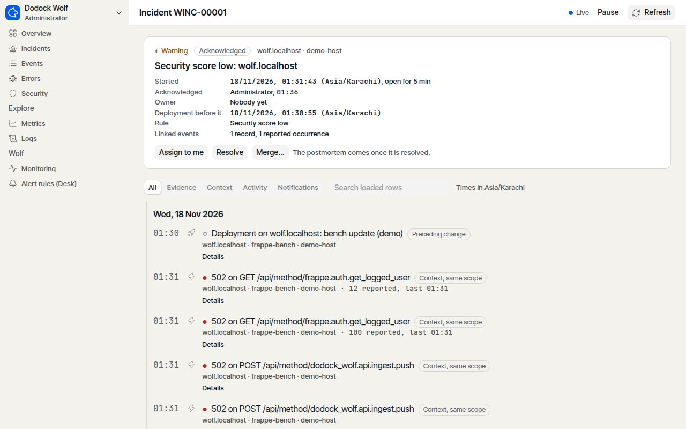
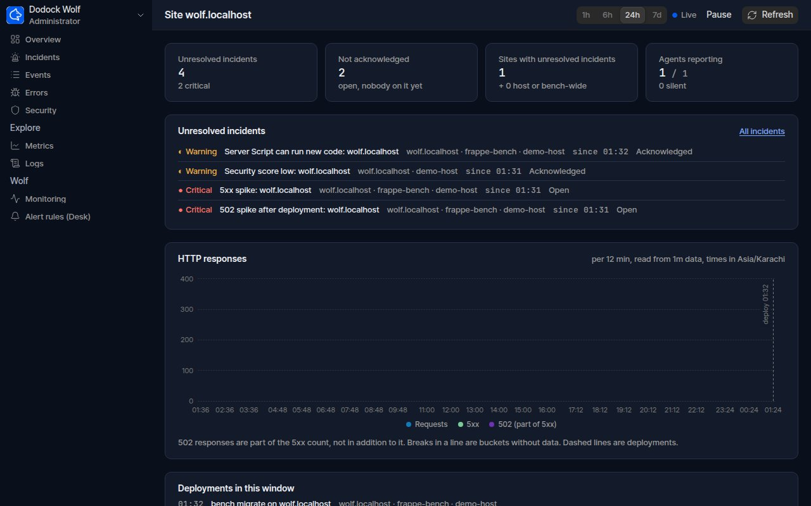
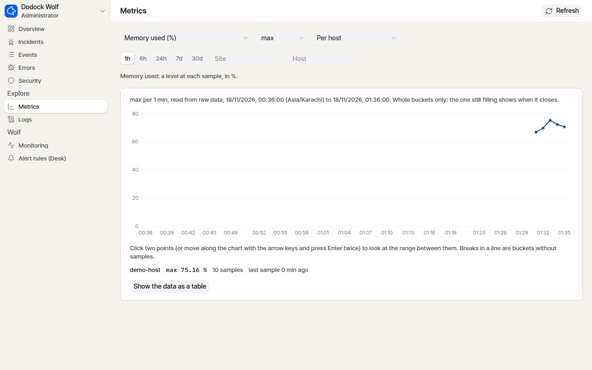
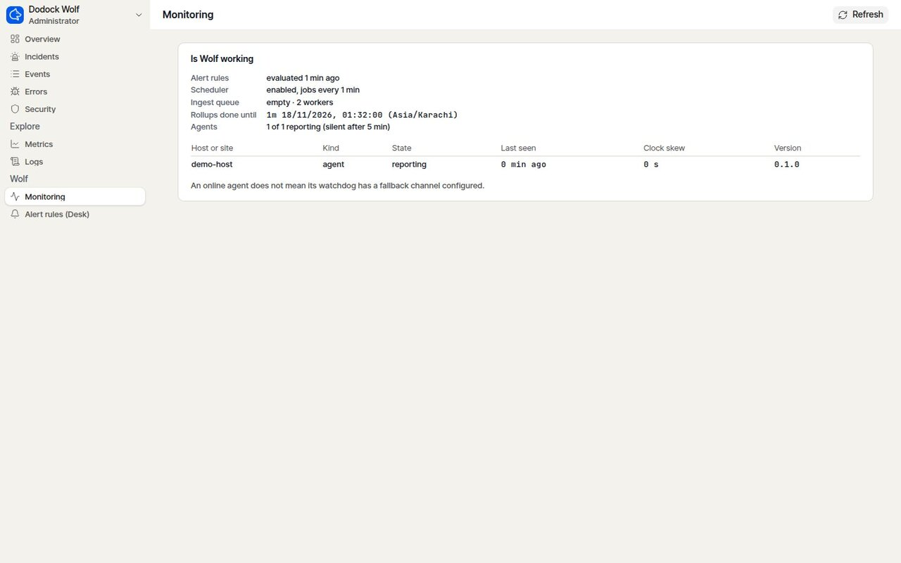
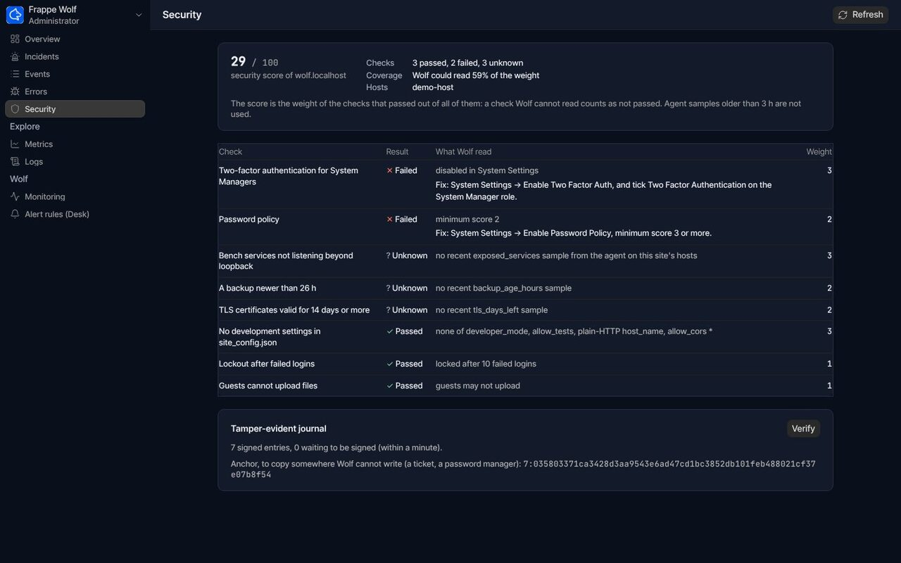

# Making Dodock Wolf

> *The night shift never sleeps.*
> The full, art-directed version of this story is in [`index.html`](index.html). The identity tokens are in [`brand.md`](brand.md).

## 01 · The brief

Dokos wanted first-class observability for Frappe benches, ERPNext and Dokos sites, Pilot benches
and their Linux hosts. It had to use open formats and self-hosted storage, and be adoptable in one
afternoon. The brief also listed non-goals: no Datadog clone, no LLM observability, no SLO
cathedrals, no RUM. Our acceptance test came from its own words:

> “The team wakes up with a clear incident timeline, not a surprise email from the customer at 9AM.”

## 02 · The idea

We didn't want another all-seeing eye. A **wolf** works the night shift. It hunts as a pack, the
host agent and the site app being two halves of one animal. And it howls once. That gave the
product its rules of behaviour: listen widely (logs and `/proc`), group before you shout
(correlate events into one incident per scope), and notify on open, reopen and resolve, never on
every event.

## 03 · Naming and voice

The product is *Dodock Wolf*, made of the *Wolf Agent* on the host and the *Wolf App* on the
site. The DocTypes keep sober names, because operators type them at 2AM. The voice is that of a
good on-call colleague: state facts, lead with scope, prefer numbers to adjectives, put the link
last, and use one wolf metaphor per screen at most.

## 04 · Identity


The founder's mark is used as supplied: a wolf head in profile drawn as a single white line, with
an angular eye slit, on an electric blue (`#035AEC`) rounded square. The palette is rebuilt
around that blue. It is the only brand colour, used for the tile, links and focus. Neutrals are
*Os* (`#F4F2EC`) and *Nuit* (`#0A0F1C`). Severity is encoded as **moon phases**, so it survives
colour blindness, greyscale and forwarded emails:

| | info | warning | critical | resolved |
|---|---|---|---|---|
| Glyph | ○ new moon | ◐ half moon | ● full moon | ✓ ring |
| Light | `#6B4FA0` | `#8A5200` | `#B0281C` | `#2E6B4A` |
| Dark | `#BBA6E6` | `#F0B04A` | `#FF7466` | `#7CC79E` |

Info is lilac moonlight, not blue, so a deployment marker never reads as the brand or as a link.
Amber means only *warning*. Logo rules (clear space, minimum size, don'ts) are in
[`brand.md`](brand.md). Type: **Instrument Serif**, **Inter Tight** and **JetBrains Mono**.

## 05 · The hero object: the incident timeline

Dashboards answer "how are things?". After a bad night the question is "what happened, in what
order, and was it the deployment?". The incident timeline answers it: every event in the
incident's scope on one rail. Illustrative example from the brief's demo scenario:

```
01:47  ○  Deployment on main: bench update
01:48  ●  502 on GET /api/method/… ×14                 nginx
01:50  ●  Incident opened, deployment linked           sum(http_502) ≥ 10 / 5 min
01:50  ◐  Notified: email + Raven
02:00  ●  Scheduled job failed                         scheduler.log
02:00  ◐  Correlated into the same incident, no second howl
   …   seven quiet hours
08:55  ✓  Acknowledged by the morning team
```

*Status:* built, in Desk and in the Wolf UI (`/wolf/incidents/<name>`). The Wolf UI's rail
interleaves four families: linked evidence, context from the same scope, operator activity and
notification attempts. Each row has a stable id. Pages come back identical whatever their size,
even when rows share a timestamp. The rail stays honest:
- a deployment before the incident is a *preceding change*, never its cause;
- a deduplicated event is one row with its count, not one row per repeat;
- a notification is *accepted by the endpoint*, which is not someone having read it;
- a long silence is *no recorded activity*, never "healthy".



## 06 · Information architecture: five rooms, then a few more

The daily views moved out of Desk into the Wolf UI at `/wolf` (#19). It's a frappe-ui app on
the same session and permissions. There were three rooms; two were added. Desk keeps
configuration.

1. **Overview** (built): exact counts, never the length of a list on screen. Then the newest
   unresolved incidents, HTTP responses with deployments marked, and every signal: workers,
   Redis, database, backups, TLS, host. Each signal is in one of five states that are never
   merged: missing, stale, unwatched, within its rules, firing. The same page serves each site,
   host and bench. A bench is always addressed through its host.
2. **Incident** (built): the timeline of chapter 05, scope first, with acknowledge, assign and
   resolve when the server allows them. Merge and split too, once the server has said what
   would move. Proposed responses wait there for a manager's approval. The postmortem starts
   there and is written in Desk.
3. **Alert Rule** (built, in Desk): a form that reads like the brief's sentence, *when X > Y for
   Z minutes, send alert*. "For Z minutes" is the `min` aggregation over the window. The form
   reads the rule back in plain words as it is edited, and rules also live in YAML, to be kept in
   git.
4. **Security** (built): a score out of 100 per site, with every check, what Wolf read and the
   fix. A check Wolf cannot read is unknown, and says so. The journal's anchor sits below, with
   a Verify button.
5. **Monitoring** (built): is Wolf itself working. When the rules were last evaluated, the
   scheduler's pace, the ingest queue, how far the rollups got, and which agents report, with
   their clock skew and what their host is missing.

Explorers came after the rooms:
- **Events**: deduplicated records with their counts;
- **Errors**: grouped by fingerprint;
- **Metrics**: the catalog decides how a metric may be read. A disk level is averaged, a count
  of 5xx responses is summed, and a sum of disk levels is refused.

Every page says what it read: window, resolution, buckets, retention, what was left out. **Logs**
explains why there is no log search yet: Wolf stores parsed events, not raw lines.







## 07 · The system: two halves of one animal

The Wolf Agent listens on the host: `/proc`, the nginx, Frappe, scheduler, worker and auth logs,
the queue Redis, and what the bench exposes. It pushes JSON over HTTPS every 30 s. The Wolf App
remembers and decides: it tags security events with ATT&CK technique ids, resolves their
entities, correlates events into incidents, evaluates rules every minute and signs its journal.
It howls through email, webhooks, Raven, Slack, Mattermost, Matrix, ntfy, Gotify, SMS and
PagerDuty, and exports to a SIEM as syslog.

The wider pack is read when it is there and never required: Suricata's `eve.json`, Wazuh's
`alerts.json` (or Wazuh posting to Wolf), and CrowdSec decisions. A block a manager approved
goes back to the host with the agent's next push.

## 08 · The protocol is an interface

`docs/protocol.md` was written before any code, because the agent and the app were built in
parallel. Its design decisions:

- UTC on the wire, local time in the UI.
- The secret is shown once and rotated on re-register. Registration is rate-limited.
- Aggregate at the edge: counts per interval, not a firehose.
- Fail closed (401/403 stops the agent) and retry open (spool to disk with backoff on 5xx or network errors).
- Two small vocabularies: six event types and a dozen metrics. Nuance goes into `category`.

## 09 · Security: nobody else sees the inside of a bench

Wolf started as observability with a few security signals. On 1 November we compared it with a
full SOC platform, SYLink's UniSOC, and decided not to match its breadth
([`docs/cyber.md`](../cyber.md)). A DPI probe or a Windows EDR are separate products. What none
of them see is the inside of a Frappe bench: DocTypes, roles and DocPerms, API keys, Server
Scripts, `site_config.json`, or who exported 40,000 customers from a report. Wolf does not build
packet inspection, a Windows or mobile EDR, phishing campaigns, an AI pentester or a 24/7 human
SOC. It reads them or forwards to them.

Six steps, each shipping without the ones after it, all built:

1. **Detect**: probes, injections and secret files served, from the nginx logs; SSH logins after
   a brute force, sudo abuse and new accounts, from the auth log; ATT&CK technique ids on every
   security event.
2. **Application**: scripts and console runs, permission drift wherever it was made, weakened
   System Settings, an API key used from a new network, exports measured against the user's own
   largest hour of the last 14 days.
3. **Posture**: a score out of 100 per site from twelve weighted checks.
4. **Deception**: decoy users, API keys and paths, where one touch is critical; offline IP
   reputation lists; CrowdSec as an option.
5. **Response**: block an IP, disable a user, log out all sessions, revoke API keys, from the
   incident page or a signed link in the alert.
6. **Evidence**: NIS2, DORA and GDPR deadlines on the incident, a tamper-evident journal, and
   export to a SIEM as syslog in OCSF or CEF.



Four rules hold it together:

- **Wolf proposes, a human approves.** Nothing runs on its own. Only what Wolf proposed from the
  incident's own events can be approved. The agent refuses private addresses and durations over
  a week, whatever the site sends. A signed link only says what to confirm, so a forwarded email
  alone cannot act.
- **Unknown is never safe.** A check Wolf cannot read counts as not passed, and the page says
  how much of the weight it could read (59% on the demo stack, for a score of 29).
- **The key is not in the database.** One job signs the journal every minute,
  `mac = HMAC-SHA256(key, seq|at|kind|record|digest|prev_mac)`, with a key kept in the site
  config. The SIEM export sends every entry out: an anchor Wolf cannot rewrite.
- **Alone is the baseline.** Suricata and Wazuh are read when they are there and never
  required. Tried against Suricata 7 with ET Open, a Wazuh 4.9.2 manager, CrowdSec 1.6.4, and
  the export against rsyslog, Wazuh and Graylog.

## 10 · Measured, then fixed

The load test put 100 hosts and 7 days of data on the demo bench, about 20 M rows
([`docs/load-test.md`](../load-test.md)). The push held (p95 115 ms). The overview did not.

| Step | The overview's slowest read |
|---|---|
| Load test (#55), rows named by random hash | 13.8 to 23.8 s |
| Rows stored in metric order (#56) | 1.5 s |
| Reads in SQL (#57) | 0.73 s, under the 1 s target |

In a browser the page is drawn in 0.9 to 1.0 s at the median, 0.53 s from the 30 s cache, and
at most 0.65 s after a quiet spell. One query went from 194 s to 0.62 s.

The wrong turns stay in the log: a table that grew by half, a 194 s read taken for an outlier,
a browser timing of the wrong site, a "cached" run that was not, and a review fix that was
measured slower and taken back.

## 11 · Build log

Append new entries at the end of their day. Mirror them in `index.html` (`#build-log`), where
they are grouped by day.

- **2026-10-29 · Brief**: CLAUDE.md adopted as the source of truth.
- **2026-10-29 · Protocol**: v1 written before code (`docs/protocol.md`).
- **2026-10-29 · Data model**: seven DocTypes generated from one spec.
- **2026-10-29 · Core**: `schema.py` and `conditions.py` kept free of Frappe imports, so they can be tested without a bench.
- **2026-10-29 · Engine**: ingest API, rule engine (metric/event signals, deployment gating, cooldown, auto-resolve), correlation, and email/webhook/Raven delivery.
- **2026-10-29 · Agent**: stdlib-only daemon with collector, rotation-aware tailer, parsers, Redis RESP client, spooling shipper, `install.sh` and a systemd unit.
- **2026-10-29 · Desk**: overview page, incident timeline, workspace, Dokos presets, local signals.
- **2026-10-29 · Identity**: official logo adopted. The palette was rebuilt around `#035AEC` and info moved to lilac.
- **2026-10-29 · Publishing**: making-of published on [GitHub Pages](https://bthuner.github.io/dodock-wolf/making-of/) (`docs/making-of/`, relative assets, OG image). Since 2026-11-17 it lives under `/making-of/`, next to the documentation site at the root (`.github/workflows/pages.yml`).
- **2026-10-29 · Alerting that holds**: an agent watchdog that alerts through its own channel when the site stops working, alert quality (flapping, cooldowns, digests), native channels (Slack, Mattermost, Matrix, ntfy, Gotify, SMS, PagerDuty), and the incident workflow (assignee, comments, merge and split, postmortems, MTTA and MTTR).
- **2026-10-29 · Press and Pilot**: benches discovered on Press servers and from Pilot's `bench.toml`. Their deploys and migrations become deployment events.
- **2026-10-29 · Privacy and access**: PII scrubbed on the host, per-site, bench and host grants for Wolf Users, hashed agent secrets, a push rate limit, and a clock-skew guard.
- **2026-10-29 · Signals**: RQ registries, queue Redis, backups, TLS expiry, MariaDB, bench processes, the email queue and GeoIP for logins.
- **2026-10-30 · Storage that scales**: minute and hour rollups with retention per resolution, reads that pick the resolution of their window exactly across raw and rolled data, and async ingest. A queued push that fails is retried and logged. A backlog shows in Wolf's health.
- **2026-10-30 · Wolf UI shell**: a frappe-ui app at `/wolf` for daily operation (#19), with the Frappe session, light and dark themes on the brand tokens, and access checks. A view not built yet says so and links to Desk.
- **2026-10-30 · Exact counts**: overview numbers computed with the reader's access rules, never from a list on screen. An inventory of hosts, benches and sites says where each one came from.
- **2026-10-30 · Incident page**: the timeline of chapter 05 in the Wolf UI, paged with a cursor, with actions checked against the incident's state on the server.
- **2026-10-30 · Dashboards**: overview, site, host and bench pages. Signals in five honest states, and HTTP with gaps kept and deployments marked.
- **2026-10-30 · Explorers**: events, error groups and metrics. The catalog governs how a metric is read, two points on a chart become a window, and every chart can be read as a table.
- **2026-11-01 · Browser and accessibility tests**: every view of the production build in Chromium, API mocked in the page, axe (WCAG 2 A/AA) in the light and dark themes, keyboard, reduced motion. They found two contrast failures (sidebar section labels, dimmed timeline times), now fixed.
- **2026-11-01 · Live updates**: invalidations over Frappe's socket.io, in rooms Frappe guards with the reader's permissions; pages refetch, never scroll on their own, and poll when there is no socket.
- **2026-11-01 · Focus restoration**: each page has a real `<h1>`, and a route change moves focus there. A button that frappe-ui disables while it works (Refresh, Comment) gets the focus back; an action that goes away (Acknowledge, Approve…) hands it to what is left nearby. Measured in Chromium before the fix: focus fell to `<body>`, and Tab started again from the top of the page.
- **2026-11-01 · Live check on the demo bench**: the demo stack in Docker, the 2AM scenario walked in the Wolf UI only (owner, evidence, webhook result, resolution), live updates over the real socket.io server with a site-scoped user refused the room of an incident outside its scope, and screenshots of real data in both themes. It found four faults the mocks could not: live updates never connected behind the demo's nginx, an incident linked a deployment made after it started, the scenario could stall Frappe's scheduler for hours by moving the clock back, and a stopped backend gave a handful of 502s instead of a window of them.
- **2026-11-01 · Merge and split in the Wolf UI**: dialogs that ask the server what would move (events, comments) and what each incident becomes, before anything does; the same checks as the actions themselves. The postmortem starts from the incident page and is written in Desk.
- **2026-11-01 · Every state of every view**: a browser test walks each view through loading, empty, filtered-empty, error, forbidden, partial, stale and disconnected. It found that most views showed nothing while loading, the incident page not even a busy button; that a refusal showed Frappe's "Not permitted"; that the timeline said "Nothing recorded" under its own error; and that the incident page's load error was not announced.
- **2026-11-01 · Load test, 100 hosts × 7 days**: about 20 M rows on the demo bench. The push holds (p95 115 ms over HTTP), but the Wolf UI's overview does not: inventory and signals take 13 to 24 s. Rows named by random hash scatter a day of rollups over the whole table, the default 128 MB buffer pool holds none of it, and MariaDB picks an index that cannot use the time range. Measured, written down, not fixed yet.
- **2026-11-01 · Rows in metric order**: InnoDB stores rows in name order, so metric rows are now named by resolution, metric and time, and inserted in that order. One more index lets the inventory read the index alone. A first try put the whole metric name in the row name: since every index entry repeats the name, the table grew by half and filled the bench's disk. Names now stay 33 characters, as long as the hash they replace. The Wolf UI's overview went from 13 to 24 s down to 1.5 s at the default 128 MB cache, the 24 h rule from 11.4 s to 0.9 s. The rest is CPU, not disk, and no index will shorten it.
- **2026-11-01 · Reads in SQL**: reads of known metrics scan the primary key by name range, and chart buckets are summed by the database instead of 144 k rows merged in Python. A full run on fresh data then found `get_signals` at 194 to 233 s: MariaDB had turned the join that picks each series' newest value into a lookup per series, each walking a metric's whole minute rollups. Runs on older data had shown it once, taken for an outlier. `row_number()` reads the rows once: 0.62 s. Every Wolf UI read is now under 1 s at 100 hosts, the slowest at 0.73 s, and Desk's 24 h chart at 0.56 s. A review fix meant to keep old-named rows off the primary key was measured slower (1.15 s against 0.77 s) and taken back.
- **2026-11-01 · The page in a browser**: `/wolf` opened in Chromium on the bench, timed from navigation start until every panel is drawn. 0.9 to 1.0 s at the median, 1.0 to 1.3 s at p95: the two slow reads (0.5 to 0.6 s each, side by side) and drawing 300 signal rows (0.1 to 0.3 s). The first try timed the wrong site: the demo's nginx serves one site whatever the host name, and the numbers were too good to be true.
- **2026-11-01 · A short cache, shared and filtered**: the inventory and signals keep what they read for 30 s. What is cached is read without access conditions, the same for everyone; each request keeps what its caller may see, so no cache entry carries one user's rights to another, and a smoke check proves it with a host-scoped user. Rules and incidents stay per request. A page served from the cache is drawn in 0.53 s, p95 0.61 s. The first "cached" run was not: Dodock's web workers keep the site config for a minute, and still read the cache as off.
- **2026-11-01 · Security orientation**: `docs/cyber.md` compares Wolf with a full SOC platform and sets a roadmap. The first slice needs no new DocType: web attacks read from the nginx logs, host intrusion signals from the auth log, and MITRE ATT&CK technique ids on every security event.
- **2026-11-01 · Security steps 2 to 6** (#47): Frappe application signals, a security score per site and bench exposure, honeytokens and offline IP reputation lists, human-validated response actions, NIS2 and GDPR deadlines on incidents, a tamper-evident HMAC journal, and SIEM export as syslog with OCSF or CEF.
- **2026-11-02 · Read again in the background**: a cached value past its 30 s is still served, up to 2 min, while one deduplicated job reads it again; every minute the scheduler reads again what was asked for in the last 10 minutes. Pages opened 45 s and 150 s apart were all served from the cache (max 0.65 s), with data 11 to 51 s old. The new job only ran once Frappe's cached hooks were cleared: `bench migrate` does that on a site, a copied `hooks.py` does not.

- **2026-11-02 · First rows**: the overview draws its first signal rows and hosts only, the rest on demand. On a load bench, drawing went from 100 to 53 ms cold.
- **2026-11-02 · Drift, exports and keys**: permission drift outside the Role Permission Manager (Custom DocPerm, User Permission, desk access), unusual data exports per user against their own largest hour, and an API key used from an address outside every network it is known from.
- **2026-11-02 · Approval from the alert**: alerts carry a signed link for each action Wolf proposes. The link only says what to confirm; only a logged-in manager's POST acts. Blocks can go through fail2ban instead of nftables, with a helper that unbans each address on time.
- **2026-11-02 · Journal retention**: a purge first writes and signs a record of where it stopped, then deletes. Verification requires a journal that does not start at entry 1 to start right after that cut. Before retention existed, a journal missing its oldest entries still verified.
- **2026-11-02 · Posture**: HSTS on the TLS check's own connection, SPF and DMARC of the mail domain from DNS, Frappe and ERPNext versions against GitHub Security Advisories, and System Settings of sites other than the Wolf site, read by the agent with the site's own credentials.
- **2026-11-02 · Evidence**: SIEM export with TLS and a private CA, newline framing and bare messages, tried on rsyslog, Wazuh and Graylog. The NIS2 intermediate report on request, and DORA's major incident deadlines.
- **2026-11-02 · CrowdSec**: decisions in, detections and approved blocks out, tried against CrowdSec 1.6.4. By default Wolf's detections carry no remediation: CrowdSec records them and decides nothing.
- **2026-11-02 · Suricata and Wazuh as optional sources** (#72): the agent reads Suricata's `eve.json` and the Wazuh manager's `alerts.json`; without an agent on the manager's host, Wazuh posts its alerts to Wolf. Tried against Suricata 7 with ET Open and a Wazuh 4.9.2 manager. Wolf alone stays the baseline.
- **2026-11-03 · Entities**: at ingest, each security event's IP, hosts, sites and users are normalised and resolved through aliases Wolf learns by itself. A Suricata address on the server becomes the host, a Wazuh agent name resolves to it, and one filter finds Wolf's, Suricata's and Wazuh's events together. Wolf never overwrites a manual alias.
- **2026-11-17 · Name**: Frappe Wolf becomes Dodock Wolf. The app, its API paths and the making-of take the new name. Wolf Agent, Wolf App and the DocTypes keep theirs.
- **2026-11-17 · One incident per attacker, across sources** (#72): a security event joins the open incident that names the same public remote IP, whatever its source, host or site. Sequence rules fire when one event follows another on the same IP, user or host: a scan, then a login from that address. A user ties events together only when it is an e-mail address: `root` on two hosts is not one person.
- **2026-11-17 · One story per incident; overlapping detectors** (#72): an incident that took events from other scopes also shows their deployments and health events, for the users allowed to see both. Where Wolf's own detector and Suricata or Wazuh overlap, the operator picks: Wolf's own, both as one finding, or the external one only.
- **2026-11-17 · Documentation site**: user documentation in `docs-site/`, in English and French, the same page at the same path in both.
- **2026-11-17 · This page**: redesigned, with chapters for security and the load test, and the log grouped by day.
- **2026-11-17 · Evidence that belongs**: an event used to join the newest open incident of its site, whatever it was about. Since the MVP, the 502s of an outage could land under *Server Script can run new code*. An incident's evidence is now what its rule matched.
- **2026-11-17 · Standalone parity** (#72): file integrity of the bench every 15 minutes, critical when files change under an unchanged git commit; outbound connections of bench users to new destinations, read from `/proc` without root, then in containers and behind a proxy, then every connection from the kernel log with an optional root helper. Blocks can go through Wazuh active response, for the host that was attacked.
- **2026-11-17 · Wolf UI redesigned**: the security score next to a weight bar, one segment per check, unknown hatched so a state is never colour alone; one look for every page.
- **2026-11-18 · Live demos through the real agent**: a Press app server, several plain benches, one bench, each backfilling history through the agent. Log signals are now aggregated at log time, so a restart or a spool replay no longer bends a chart.
- **2026-11-18 · Detection kept up to date** (#72): edge appliance paths, more secret files, and two Frappe rules that count bursts, written from the list of every method a guest can call. Fixtures from real Suricata and Wazuh, a coverage table for Wolf alone, with Suricata and with Wazuh, and a bench smoke where the three report one IP and open one incident. An incident a rule opens also takes the same attacker's earlier events: on the demo bench, nginx, Suricata and Wazuh saw one attack within seconds, and the incident opened a minute later held only its own.
- **2026-11-18 · Dashboards**: hosts, benches and sites drawn as a schematic, with a filter; a range dragged on the HTTP chart becomes the window of the page.
- **2026-11-18 · Press and Pilot, for real** (#17, #114): a Press app server built by Press's own Ansible roles, then its proxy server, its backups and its shared filesystem; a Pilot host on v1.0.0-rc.1, then rc.2. Each found what the source alone had missed. The worst: opening the Press agent's `jobs.sqlite3` read-only, after its last connection closed, created files that then made every Press job fail. Also checked on real hosts: blocks through nftables and fail2ban, and the auth log on a journald-only host.
- **2026-11-18 · Onboarding** (#23): `wolf-agent doctor` says what a host gives the agent and the fix for each problem. The agent runs it every hour, and the Monitoring page shows each host's setup.
- **2026-11-18 · Rules**: export and import as YAML, a dry run first and all or nothing, secrets never in a file; and the rule form reads the rule back in plain words as it is edited.

## 12 · Trade-offs

- **Python, not Rust, for the agent:** contributors can read it on day one. The protocol allows a Rust agent later.
- **DocTypes, not ClickHouse:** storage you already back up, with retention settings.
- **Thresholds, not ML:** a rule you can read is a rule you can trust at 2AM.
- **Desk, not a separate SPA** (superseded by #19): no new logins, native permissions. The daily operator views now live in a frappe-ui app at `/wolf` that reuses the Frappe session and permissions; Desk keeps configuration.
- **Honest numbers over pretty ones:** a gap stays a gap, a missing signal is not a zero, a repeat count is not a count for the window, and a past window is not "stale". Every page says what it read. A chart that looks calm because it hides what it doesn't know would wake no one at 2AM.

- **The inside of the bench, not the whole estate:** Wolf covers what a network probe or an EDR cannot know about Frappe, and forwards everything to the organisation's SOC in a standard form.
- **Approval, not automation:** Wolf proposes a response and a manager approves it. When CrowdSec is asked to decide on detections, that is CrowdSec's choice, and the setting says so.

## Next

- **French in the app:** the documentation is in English and French; Desk and the Wolf UI are in English only.
- **An onboarding checklist** in the Wolf UI, from the first agent to the first test alert.
- **Packages:** `.deb`, `.rpm` and PyPI for the agent, with auto-update, then the Frappe Marketplace.
- **Log search:** waits for raw-line storage, which Wolf deliberately doesn't have yet.
- **The overview's first visit at 100 hosts:** a visit the background reads do not cover (the first in 10 quiet minutes on a scope) still takes 0.9 to 1.2 s ([`docs/load-test.md`](../load-test.md)).
