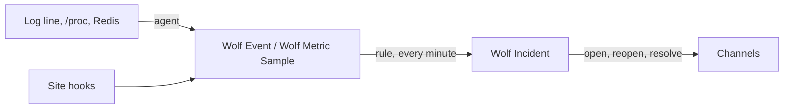

# Concepts

> The few objects Dodock Wolf is made of, and how a log line becomes an alert.

## Scope: site, bench, host

Every record carries up to three names. Wolf always reads them in this order:

<table>
<thead>
  <tr>
    <th>
      Scope
    </th>
    
    <th>
      Is
    </th>
    
    <th>
      Example
    </th>
  </tr>
</thead>

<tbody>
  <tr>
    <td>
      <strong>
        site
      </strong>
    </td>
    
    <td>
      a Frappe site
    </td>
    
    <td>
      <code>
        erp.client.com
      </code>
    </td>
  </tr>
  
  <tr>
    <td>
      <strong>
        bench
      </strong>
    </td>
    
    <td>
      the bench that serves it
    </td>
    
    <td>
      <code>
        frappe-bench
      </code>
    </td>
  </tr>
  
  <tr>
    <td>
      <strong>
        host
      </strong>
    </td>
    
    <td>
      the Linux machine the agent runs on
    </td>
    
    <td>
      <code>
        bench-01
      </code>
    </td>
  </tr>
</tbody>
</table>

Host-wide records (CPU, disk, SSH logins) have no site. Rules group by one of these, and
[user scopes](/security/access) restrict who sees which.

## From a log line to an alert

1. The **agent** parses logs and reads system state. It sends events and metric samples every
`push_interval` (30 s).
2. The **site** stores them. Events with the same fingerprint are counted on one row (**Count**,
**Last Seen**) instead of piling up.
3. Every minute, each **alert rule** reads its window. When its condition holds, it opens an
**incident** per group, or feeds the incident already open.
4. The incident notifies its **channels** when it opens, reopens, escalates and resolves, never
on every event.

## The objects

<table>
<thead>
  <tr>
    <th>
      DocType
    </th>
    
    <th>
      What it holds
    </th>
  </tr>
</thead>

<tbody>
  <tr>
    <td>
      <strong>
        Wolf Event
      </strong>
    </td>
    
    <td>
      Something that happened: <code>
        error
      </code>
      
      , <code>
        cron_failure
      </code>
      
      , <code>
        worker_failure
      </code>
      
      , <code>
        security
      </code>
      
      , <code>
        host_metric_alert
      </code>
      
      , <code>
        deployment
      </code>
      
      . Has a category (for example <code>
        web_attack_probe
      </code>
      
      ), a severity (<code>
        info
      </code>
      
      , <code>
        warning
      </code>
      
      , <code>
        critical
      </code>
      
      ), a scope, a count and a JSON payload.
    </td>
  </tr>
  
  <tr>
    <td>
      <strong>
        Wolf Metric Sample
      </strong>
    </td>
    
    <td>
      One value of one metric (<code>
        cpu_usage
      </code>
      
      , <code>
        http_502
      </code>
      
      , <code>
        tls_days_left
      </code>
      
      …) for one scope at one time. Rolled up into <strong>
        Wolf Metric Rollup
      </strong>
      
       by minute and by hour. See <a href="/reference/metric-storage">
        Metric storage
      </a>
      
      .
    </td>
  </tr>
  
  <tr>
    <td>
      <strong>
        Wolf Alert Rule
      </strong>
    </td>
    
    <td>
      <em>
        When X > Y for Z minutes, send alert.
      </em>
      
       Signal, aggregation, window, group by, channels. See <a href="/alerts/rules">
        Alert rules
      </a>
      
      .
    </td>
  </tr>
  
  <tr>
    <td>
      <strong>
        Wolf Incident
      </strong>
    </td>
    
    <td>
      Events that share a cause, for one group of one rule. Status <code>
        Open
      </code>
      
      , <code>
        Acknowledged
      </code>
      
       or <code>
        Resolved
      </code>
      
      . Linked to the deployment that preceded it. See <a href="/alerts/incidents">
        Incidents
      </a>
      
      .
    </td>
  </tr>
  
  <tr>
    <td>
      <strong>
        Wolf Silence
      </strong>
    </td>
    
    <td>
      A maintenance window: incidents still open, notifications wait.
    </td>
  </tr>
  
  <tr>
    <td>
      <strong>
        Wolf Agent
      </strong>
    </td>
    
    <td>
      One registered host, satellite site or integration, with its last push and clock skew.
    </td>
  </tr>
  
  <tr>
    <td>
      <strong>
        Wolf Settings
      </strong>
    </td>
    
    <td>
      Retention, signals, agents, SIEM export, threat intelligence.
    </td>
  </tr>
</tbody>
</table>

## Severity

Each severity has a colour and a shape, so it never depends on colour alone:

<table>
<thead>
  <tr>
    <th>
      Severity
    </th>
    
    <th>
      Glyph
    </th>
    
    <th>
      Meaning
    </th>
  </tr>
</thead>

<tbody>
  <tr>
    <td>
      <code>
        info
      </code>
    </td>
    
    <td>
      ○
    </td>
    
    <td>
      Worth knowing.
    </td>
  </tr>
  
  <tr>
    <td>
      <code>
        warning
      </code>
    </td>
    
    <td>
      ◐
    </td>
    
    <td>
      Look at it today.
    </td>
  </tr>
  
  <tr>
    <td>
      <code>
        critical
      </code>
    </td>
    
    <td>
      ●
    </td>
    
    <td>
      Someone wakes up.
    </td>
  </tr>
  
  <tr>
    <td>
      resolved
    </td>
    
    <td>
      ✓
    </td>
    
    <td>
      Back to normal.
    </td>
  </tr>
</tbody>
</table>

## Deployments

A `deployment` event marks the moment code changed: a `bench migrate` on the Wolf site, a
Pilot task, or `wolf-agent mark-deployment`. Rules can require a recent deployment (the
*502 spike after deployment* preset), and incidents show the deployment that preceded them, so the
timeline reads "502s started 4 minutes after the 01:47 deploy".

## Where to look

- **Wolf UI** at `/wolf`: overview, incidents, explorers, security, monitoring. For Wolf
Users and Wolf Managers.
- **Desk**: every DocType, configuration, reports such as **Wolf Incident Metrics**.
